# Tài Liệu Kỹ Thuật: Tích Hợp SSO HCMUT & Hệ Thống API myBK

Tài liệu này mô tả toàn bộ cơ chế hoạt động, luồng xác thực **SSO CAS (`sso.hcmut.edu.vn`)**, cách lấy **JWT Token (`hid_Token`)** từ **`mybk.hcmut.edu.vn/app`**, đặc tả chi tiết các API Kết quả học tập và cấu trúc hiện thực trong dự án **MTWorkspace**.

---

## 1. Kiến Trúc Tổng Quan & Luồng Xác Thực SSO HCMUT

Hệ thống `mybk.hcmut.edu.vn/app` sử dụng hai tầng bảo mật:
1. **Tầng đăng nhập giao diện Web (`/app`):** Sử dụng giao thức **Apereo CAS** qua cổng `sso.hcmut.edu.vn` để cấp cookie phiên làm việc `SESSION` (Spring Session).

```mermaid
sequenceDiagram
    autonumber
    participant App as MTWorkspace Backend
    participant SSO as sso.hcmut.edu.vn (CAS)
    participant MyBKWeb as mybk.hcmut.edu.vn/app
    participant MyBKApi as mybk.hcmut.edu.vn/api

    App->>SSO: GET /cas/login?service=https://mybk.hcmut.edu.vn/app/login/cas
    SSO-->>App: Trả về Cookie JSESSIONID + HTML chứa hidden input (lt, execution)
    App->>SSO: POST /cas/login (username, password, lt, execution, _eventId=submit)
    SSO-->>App: HTTP 302 Redirect kèm Service Ticket (?ticket=ST-...)
    App->>MyBKWeb: GET /app/login/cas?ticket=ST-...
    MyBKWeb-->>App: Xác thực Ticket thành công -> Cấp Cookie SESSION=...
    App->>MyBKWeb: GET /app/ (kèm Cookie SESSION)
    MyBKWeb-->>App: Trả về HTML chứa <input id="hid_Token" value="JWT_TOKEN" />
    Note over App: Giải mã JWT lấy "sub" (MSSV, VD: "2313425") & "exp"
    App->>MyBKApi: POST /api/share/ket-qua-hoc-tap/... (Header: authorization = JWT_TOKEN)
    MyBKApi-->>App: Trả về JSON dữ liệu Học kỳ & Bảng điểm môn học
```

2. **Tầng gọi dữ liệu REST API (`/api`):** Khi đã có cookie `SESSION`, trang HTML của `/app/` sẽ nhúng một thẻ `<input type="hidden" id="hid_Token" value="eyJhbGciOiJIUzUxMiJ9..." />`. Toàn bộ các API dưới `https://mybk.hcmut.edu.vn/api/...` đều dùng giá trị `hid_Token` này trong header `authorization`.



---

## 2. Chi Tiết 4 Bước Lấy JWT Token Từ SSO HCMUT (Pure HTTP)

Không cần dùng trình duyệt ẩn (Playwright/Puppeteer), hệ thống thực hiện 4 bước HTTP thuần trong [src/lib/mybk.ts](file:///d:/Project/MTWorkspace/src/lib/mybk.ts):

### Bước 1: Lấy CSRF Token (`lt`, `execution`) và `JSESSIONID` từ trang CAS
- **Request:**
  ```http
  GET https://sso.hcmut.edu.vn/cas/login?service=https%3A%2F%2Fmybk.hcmut.edu.vn%2Fapp%2Flogin%2Fcas
  ```
- **Dữ liệu cần bóc tách từ Response:**
  - Header `Set-Cookie`: Lưu lại `JSESSIONID=...`
  - Trong HTML `<form id="fm1">`:
    - `<input type="hidden" name="lt" value="LT-..." />`
    - `<input type="hidden" name="execution" value="e1s1" />`
    - Thuộc tính `action` của form `/cas/login;jsessionid=...?service=...`

### Bước 2: Gửi thông tin tài khoản BKNetID lên CAS
- **Request:**
  ```http
  POST https://sso.hcmut.edu.vn/cas/login;jsessionid=...?service=https%3A%2F%2Fmybk.hcmut.edu.vn%2Fapp%2Flogin%2Fcas
  Content-Type: application/x-www-form-urlencoded
  Cookie: JSESSIONID=...

  username=<bknet_username>&password=<bknet_password>&lt=<LT-...>&execution=e1s1&_eventId=submit&submit=Login
  ```
- **Kết quả:**
  - Nếu đúng mật khẩu: CAS trả về **`HTTP 302 Found`** với header:
    `Location: https://mybk.hcmut.edu.vn/app/login/cas?ticket=ST-xxxxx-sso.hcmut.edu.vn`
  - Nếu sai mật khẩu: CAS trả về `HTTP 200 OK` hiển thị lại trang form đăng nhập.

### Bước 3: Đổi Service Ticket (`ST-...`) lấy Cookie `SESSION` trên myBK
- **Request:**
  ```http
  GET https://mybk.hcmut.edu.vn/app/login/cas?ticket=ST-xxxxx-sso.hcmut.edu.vn
  ```
- **Kết quả:** Server `mybk.hcmut.edu.vn` kiểm tra ticket với CAS và trả về chuỗi `302 Redirect` về `/app/` kèm theo header:
  ```http
  Set-Cookie: SESSION=<base64_session_id>; Path=/app; HttpOnly; SameSite=Lax
  ```

### Bước 4: Bóc tách `#hid_Token` (JWT) và giải mã Mã số sinh viên (`MSSV`)
- **Request:**
  ```http
  GET https://mybk.hcmut.edu.vn/app/
  Cookie: SESSION=<base64_session_id>
  ```
- **Bóc tách từ HTML trả về:**
  Trong mã nguồn trang `/app/` luôn có 3 thẻ `<input type="hidden">`:
  ```html
  <input type="hidden" id="hid_Token" value="eyJhbGciOiJIUzUxMiJ9.eyJzdWIiOiIyMzEzNDI1IiwiaWF0IjoxNzk1NTE0MTA0LCJleHAiOjE3OTU1MjEzMDR9.xxx">
  <input type="hidden" id="hid_APiUrl" value="https://mybk.hcmut.edu.vn/api/">
  <input type="hidden" id="hid_Language" value="vi">
  ```
- **Cấu trúc Payload bên trong `hid_Token` (khi giải mã Base64 phần giữa của JWT):**
  ```json
  {
    "sub": "2313425",
    "iat": 1795514104,
    "exp": 1795521304
  }
  ```
  - `sub`: Chính là **Mã số sinh viên (`MSSV`)** dùng làm `body` khi gọi các API của myBK.
  - `iat`: Thời điểm cấp Token (Unix timestamp tính bằng giây).
  - `exp`: Thời điểm hết hạn Token (thường có hiệu lực trong **2 giờ** = `7200 giây`).

---

## 3. Đặc Tả Chi Tiết Các API Kết Quả Học Tập Trên myBK

Tất cả các request gọi tới `https://mybk.hcmut.edu.vn/api/...` đều sử dụng chung bộ Headers sau:

### 3.1. Bộ Headers Chuẩn
| Tên Header | Giá trị | Ghi chú |
| :--- | :--- | :--- |
| `accept` | `application/json` | Bắt buộc |
| `accept-language` | `vi` | Ngôn ngữ tiếng Việt |
| `authorization` | `<Giá trị JWT hid_Token>` | **Lưu ý:** Truyền trực tiếp chuỗi JWT `eyJhbGci...` (không cần tiền tố `Bearer `) |
| `content-type` | `application/json` | Bắt buộc vì body gửi dạng chuỗi JSON `"\"2313425\""` |
| `traceparent` | `01-<32_hex_trace_id>-<16_hex_span_id>-01` | Chuẩn W3C Trace Context sinh ngẫu nhiên (theo hàm `generateTraceparent()` trong `main.js` của myBK) |
| `Referer` | `https://mybk.hcmut.edu.vn/app/sinh-vien/ket-qua-hoc-tap/bang-diem-mon-hoc` | Trang nguồn trên myBK |

---

### 3.2. API 1: Lấy Danh Sách Điểm Tổng Kết Theo Học Kỳ (`BANGDIEM_HOCKY`)

Lấy danh sách toàn bộ các học kỳ mà sinh viên đã học kèm GPA từng học kỳ, CPA tích lũy và số tín chỉ tích lũy.

- **URL:**
  ```
  POST https://mybk.hcmut.edu.vn/api/share/ket-qua-hoc-tap/danh-sach-diem-hoc-ky-mon-hoc/v2?tuychon=BANGDIEM_HOCKY
  ```
- **Request Body:** Chuỗi JSON chứa Mã số sinh viên (có dấu ngoặc kép bao ngoài):
  ```json
  "2313425"
  ```
- **Response Mẫu:**
  ```json
  {
    "code": "200",
    "msg": "done",
    "data": [
      {
        "sinhVienId": 211441,
        "namHocHocKyId": 603,
        "maNamHocHocKy": "BL",
        "namHocHocKyTen": "Môn học chuyển điểm/miễn điểm",
        "soTCTLHocKy": 8,
        "diemTBTLHocKy": "0.0",
        "soTCTLChung": "8",
        "diemTBTLChung": "0.0",
        "capNhatCuoi": "23/07/2025 19:33",
        "code": "0",
        "msg": "done"
      },
      {
        "sinhVienId": 211441,
        "namHocHocKyId": 713,
        "maNamHocHocKy": "20252",
        "namHocHocKyTen": "Năm học 2025 - 2026 / Học kỳ 2",
        "soTCTLHocKy": 23,
        "diemTBTLHocKy": "3.8",
        "soTCTLChung": "116",
        "diemTBTLChung": "3.5",
        "capNhatCuoi": "28/08/2026 17:10",
        "code": "0",
        "msg": "done"
      }
    ],
    "sign": ""
  }
  ```

- **Giải thích ý nghĩa các trường trong `data[]`:**
  | Trường | Kiểu dữ liệu | Ý nghĩa |
  | :--- | :--- | :--- |
  | `sinhVienId` | `number` | ID nội bộ của sinh viên trong CSDL Phòng Đào tạo (VD: `211441`). |
  | `namHocHocKyId` | `number` | ID nội bộ của học kỳ (VD: `713`, `714`, `603`). Dùng để nối với danh sách môn học. |
  | `maNamHocHocKy` | `string` | Mã học kỳ chuẩn Bách Khoa: `YYYY` + `Kỳ (1, 2, 3)` (VD: `"20252"` là HK2 năm 2025-2026) hoặc `"BL"` (Môn bảo lưu / chuyển điểm / miễn điểm). |
  | `namHocHocKyTen` | `string` | Tên hiển thị đầy đủ của học kỳ. |
  | `soTCTLHocKy` | `number` | Số tín chỉ tích lũy đạt được trong riêng học kỳ đó. |
  | `diemTBTLHocKy` | `string` | Điểm trung bình học kỳ (**GPA học kỳ** theo thang 4.0, VD: `"3.8"`). |
  | `soTCTLChung` | `string` | Tổng số tín chỉ tích lũy cộng dồn tính đến hết học kỳ đó (VD: `"116"`). |
  | `diemTBTLChung` | `string` | Điểm trung bình tích lũy chung (**CPA tích lũy** theo thang 4.0 tính đến hết học kỳ đó, VD: `"3.5"`). |
  | `capNhatCuoi` | `string` | Thời điểm phòng Đào tạo cập nhật bảng điểm lần cuối (`DD/MM/YYYY HH:mm`). |

---

### 3.3. API 2: Lấy Danh Sách Điểm Chi Tiết Từng Môn Học (`BANGDIEM_MONHOC`)

Lấy toàn bộ danh sách các môn học đã đăng ký và có điểm qua tất cả các học kỳ.

- **URL:**
  ```
  POST https://mybk.hcmut.edu.vn/api/share/ket-qua-hoc-tap/danh-sach-diem-hoc-ky-mon-hoc/v2?tuychon=BANGDIEM_MONHOC
  ```
- **Request Body:**
  ```json
  "2313425"
  ```
- **Response Mẫu:**
  ```json
  {
    "code": "200",
    "msg": "done",
    "data": [
      {
        "sinhVienId": 211441,
        "namHocHocKyId": 645,
        "maHocKy": "20231",
        "monHocId": 6655,
        "maMonHoc": "PH1003",
        "tenMonHoc": "Vật lý 1",
        "soTinChi": 4,
        "diemChu": "B",
        "diemSo": 7.6,
        "diemDat": "1",
        "tinhTrangDiem": null,
        "diemKhongIn": "0",
        "nhomTo": "L20",
        "ghiChu": null,
        "code": "0",
        "msg": "done"
      },
      {
        "sinhVienId": 211441,
        "namHocHocKyId": 603,
        "maHocKy": "BL",
        "monHocId": 6662,
        "maMonHoc": "LA1005",
        "tenMonHoc": "Anh văn 2",
        "soTinChi": 2,
        "diemChu": "MT",
        "diemSo": 12,
        "diemDat": "1",
        "tinhTrangDiem": null,
        "diemKhongIn": "0",
        "nhomTo": null,
        "ghiChu": "226/BKDT-17/01/2024",
        "code": "0",
        "msg": "done"
      }
    ],
    "sign": ""
  }
  ```

- **Giải thích ý nghĩa các trường & Quy ước mã điểm đặc biệt của myBK:**
  | Trường | Kiểu dữ liệu | Ý nghĩa & Quy ước xử lý |
  | :--- | :--- | :--- |
  | `namHocHocKyId` | `number` | Khớp với `namHocHocKyId` của API `BANGDIEM_HOCKY`. |
  | `maHocKy` | `string` | Khớp với `maNamHocHocKy` của API `BANGDIEM_HOCKY` (VD: `"20231"`, `"20252"`, `"BL"`). |
  | `monHocId` | `number` | ID nội bộ của môn học. |
  | `maMonHoc` | `string` | Mã môn học Bách Khoa (VD: `"PH1003"`, `"CO1023"`, `"LA1005"`, `"SA4001"`). |
  | `tenMonHoc` | `string` | Tên môn học tiếng Việt. |
  | `soTinChi` | `number` | Số tín chỉ của môn học (VD: `4`, `3`, `2`, `0`). |
  | `diemSo` | `number \| null` | Điểm tổng kết hệ 10 (từ `0.0` đến `10.0`). **Quy ước đặc biệt của myBK:** Nếu `diemSo > 10` thì đó là mã trạng thái đặc biệt: `12` = Miễn (`MT`), `21` = Đạt (`DT`, ví dụ môn Hoạt động sinh viên `SA4001`). Trên UI cần hiển thị là `"Miễn"` hoặc `"Đạt"` thay vì hiện số `12` hay `21`. |
  | `diemChu` | `string \| null` | Điểm chữ quy đổi: `A+`, `A`, `B+`, `B`, `C+`, `C`, `D+`, `D`, `F`, hoặc mã đặc biệt `MT` (Miễn), `DT` (Đạt). |
  | `diemDat` | `string \| null` | `"1"` = Đạt môn học; `"0"` = Chưa đạt; `"-1"` = Môn không xét tín chỉ (VD: CTXH/Hoạt động sinh viên). |
  | `nhomTo` | `string \| null` | Lớp / Nhóm-Tổ đăng ký (VD: `"L20"`, `"L02"`). |
  | `ghiChu` | `string \| null` | Ghi chú quyết định miễn điểm (VD: `"226/BKDT-17/01/2024"`) hoặc số ngày CTXH (`"15.00 ngay"`). |

---

## 4. Cấu Trúc Hiện Thực Trong Codebase `MTWorkspace`

Toàn bộ tính năng tích hợp SSO HCMUT và Kết quả học tập được tổ chức thành 4 lớp rõ ràng:

### 4.1. Lớp Cơ sở dữ liệu ([prisma/schema.prisma](file:///d:/Project/MTWorkspace/prisma/schema.prisma))
- **`MyBkAccount`**: Lưu `studentId` (MSSV), `sinhVienId`, `ssoUsername`, `encryptedPassword` (mã hóa chuẩn **AES-256-GCM** bằng khóa dẫn xuất SHA-256 từ `SESSION_SECRET`), `jwtToken` (`hid_Token`) và `tokenExpiresAt`.
- **`AcademicSemester`**: Lưu danh sách học kỳ từ `BANGDIEM_HOCKY`, liên kết khóa ngoại với `MyBkAccount`.
- **`AcademicCourseGrade`**: Lưu danh sách điểm môn học từ `BANGDIEM_MONHOC`, đánh chỉ mục theo `[studentId, maHocKy]`.

### 4.2. Lớp Core Service ([src/lib/mybk.ts](file:///d:/Project/MTWorkspace/src/lib/mybk.ts))
- `loginMyBkCasSso(username, password)`: Thực hiện tự động 4 bước đăng nhập CAS để trả về `{ jwtToken, studentId }`.
- `fetchMyBkAcademicTranscript(jwtToken, studentId)`: Gọi song song `BANGDIEM_HOCKY` và `BANGDIEM_MONHOC`.
- `saveAndSyncMyBkTranscript(...)`: Lưu dữ liệu đồng thời vào **PostgreSQL** và file cache cục bộ `.mybk-transcript-cache.json` (giúp hệ thống vẫn xem được bảng điểm tức thì kể cả khi chưa bật Docker PostgreSQL).
- `encryptCredential` / `decryptCredential`: Mã hóa AES-256-GCM thông tin đăng nhập SSO để phục vụ tự động làm mới Token khi hết hạn 2 giờ.

### 4.3. Lớp Internal API Routes (Next.js App Router)
1. **`POST /api/mybk/connect`** ([src/app/api/mybk/connect/route.ts](file:///d:/Project/MTWorkspace/src/app/api/mybk/connect/route.ts)):
   - Nhận `mode: "sso"` (`username`, `password`) hoặc `mode: "token"` (`jwtToken`, `studentId`).
   - Xác thực, đồng bộ bảng điểm từ myBK và lưu vào DB.
2. **`DELETE /api/mybk/connect`**:
   - Ngắt kết nối tài khoản myBK và xóa dữ liệu phiên.
3. **`GET /api/mybk/transcript`** ([src/app/api/mybk/transcript/route.ts](file:///d:/Project/MTWorkspace/src/app/api/mybk/transcript/route.ts)):
   - Trả về toàn bộ dữ liệu học kỳ, điểm môn học và trạng thái kết nối đã lưu để hiển thị tức thì trên UI.
4. **`POST /api/mybk/transcript`**:
   - Làm mới dữ liệu từ myBK. Nếu `jwtToken` hiện tại đã hết hạn (sau 2 tiếng) và người dùng đã kết nối bằng chế độ SSO, API sẽ **tự động giải mã thông tin SSO, đăng nhập lại CAS ngầm để lấy `jwtToken` mới** và đồng bộ dữ liệu mà người dùng không cần nhập lại mật khẩu.

### 4.4. Lớp Giao diện Người dùng (Frontend UI)
1. **Modal Kết nối SSO myBK** ([src/components/mybk/mybk-connect-modal.tsx](file:///d:/Project/MTWorkspace/src/components/mybk/mybk-connect-modal.tsx)):
   - Mở từ nút **`Đồng bộ myBK`** trên [Header](file:///d:/Project/MTWorkspace/src/components/layout/header.tsx) hoặc trong trang Kết quả học tập.
   - Hỗ trợ chuyển đổi giữa 2 tab: **Tài khoản SSO** và **Token trực tiếp**.
2. **Trang Kết quả học tập (`/academic-results`)** ([src/app/academic-results/page.tsx](file:///d:/Project/MTWorkspace/src/app/academic-results/page.tsx)):
   - Gồm 2 tab: **`Bảng điểm học kỳ`** và **`Tiến độ học tập`**.
   - Hiển thị 4 thẻ chỉ số tổng quan (`CPA tích lũy`, `Tín chỉ tích lũy`, `GPA kỳ gần nhất`, `Tổng môn học`), bộ lọc LOV theo Học kỳ & Điểm chữ, tìm kiếm mã/tên môn và bảng điểm chi tiết từng học kỳ.
3. **Trang Tổng quan (`/`)** ([src/app/page.tsx](file:///d:/Project/MTWorkspace/src/app/page.tsx)):
   - Thẻ **`GPA / CPA`** tự động hiển thị điểm CPA và tổng tín chỉ tích lũy mới nhất, bấm vào sẽ điều hướng thẳng tới `/academic-results`.


---

### 3.4. API 3: Lấy Danh Sách Điểm Môn Học Khác & Chứng Chỉ Điều Kiện (`danh-sach-diem-mon-hoc-khac/v2`)

Lấy danh sách các môn học đặc thù, chứng chỉ Giáo dục thể chất, Chuẩn CNTT cơ bản, Ngày công tác xã hội và xét trình độ năm học.

- **URL:**
  ```
  POST https://mybk.hcmut.edu.vn/api/share/ket-qua-hoc-tap/danh-sach-diem-mon-hoc-khac/v2?tuychon=BANGDIEM_MONHOC
  ```
- **Request Body:**
  ```json
  "2313425"
  ```
- **Response Mẫu:**
  ```json
  {
    "code": "200",
    "msg": "done",
    "data": [
      {
        "maHocKy": "20232",
        "maMonHoc": "CCGDTC",
        "tenMonHoc": "Giáo dục thể chất",
        "diemSo": "21",
        "diemdat": "--",
        "ghiChu": "Đạt",
        "capNhatCuoi": "14/10/2024 15:56:43"
      },
      {
        "maHocKy": "20241",
        "maMonHoc": "CNTTCB",
        "tenMonHoc": "Chuẩn kỹ năng ứng dụng Công nghệ thông tin cơ bản",
        "diemSo": "21",
        "diemdat": "--",
        "ghiChu": "Đạt",
        "capNhatCuoi": "05/12/2024 16:05:21"
      }
    ],
    "sign": ""
  }
  ```

---

### 3.5. Modal Xem Chi Tiết Môn Học & Bảng Điểm Thành Phần (`CourseDetailModal`)

Khi bấm vào bất kỳ dòng môn học nào trên trang `/academic-results` ([src/components/mybk/course-detail-modal.tsx](file:///d:/Project/MTWorkspace/src/components/mybk/course-detail-modal.tsx) & API `/api/mybk/course-detail`):
1. **Hiển thị 4 chỉ số cốt lõi của môn:** Điểm tổng kết thang 10 (`diemSo`), Điểm chữ (`diemChu`), Điểm quy đổi thang 4.0 (`4.0`, `3.5`, `3.0`, ...) và Số tín chỉ (`soTinChi`).
2. **Bảng Chi Tiết Điểm Thành Phần (`BT`, `TN`, `BTL`, `GK`, `CK`):**
   - Hiển thị đầy đủ các cột thành phần đánh giá (`Bài tập`, `Thí nghiệm`, `Bài tập lớn`, `Giữa kỳ`, `Cuối kỳ`) kèm tỷ lệ `%` và điểm từng cột.
   - Hỗ trợ chỉnh sửa tỷ lệ `%`, nhập điểm thành phần, thêm/xóa cột thành phần và lưu trực tiếp vào PostgreSQL (`AcademicCourseGrade.componentScoresJson`) + Cache cục bộ.
3. **Toàn bộ Metadata Học vụ từ myBK API:** Hiển thị `maMonHoc`, `monHocId`, `maHocKy`, `namHocHocKyId`, `nhomTo`, `diemDat`, `diemKhongIn`, `ghiChu`, `capNhatCuoi`.
4. **Lịch sử đăng ký môn học qua các kỳ & Chứng chỉ liên quan:** Tự động gom tất cả các lần học môn đó qua các kỳ (ví dụ môn rút `RT` hoặc học cải thiện) cùng bản ghi đối chiếu từ `danh-sach-diem-mon-hoc-khac/v2`.


---

### 3.6. API 4: Lấy Chi Tiết Điểm Thành Phần Của Từng Môn Học (`thong-tin-tinh-trang-diem-thanh-phan-mon-hoc/v2`)

Lấy danh sách toàn bộ các cột điểm thành phần (`K.Tra`, `B.Tập`, `TNg`, `BTL/ĐA`, `Thi`, `Điểm tổng kết`) cùng tỷ lệ `%` và tình trạng điểm (`Chính thức`) cho tất cả các môn học của sinh viên.

- **URL:**
  ```
  POST https://mybk.hcmut.edu.vn/api/share/ket-qua-hoc-tap/thong-tin-tinh-trang-diem-thanh-phan-mon-hoc/v2
  ```
- **Request Body:** Truyền `sinhVienId` nội bộ (lấy từ `semesters[0].sinhVienId`, ví dụ `"211441"`):
  ```json
  211441
  ```
- **Response Mẫu:**
  ```json
  {
    "code": "200",
    "msg": "done",
    "data": [
      {
        "sinhVienId": 211441,
        "namHocHocKyId": 644,
        "monHocId": 6652,
        "maTinhTrang": "CTH",
        "tenTinhTrang": "Chính thức",
        "diemThanhPhanJson": "[{\"ma\":\"tket\",\"ten\":\"Điểm tổng kết\",\"tyle\":100,\"diem\":7.6},{\"ma\":\"tkethp\",\"ten\":\"Điểm tổng kết\",\"tyle\":100,\"diem\":7.6},{\"ma\":\"kiemTra\",\"ten\":\"K.Tra\",\"tyle\":25,\"diem\":7},{\"ma\":\"baiTapThucHanh\",\"ten\":\"B.Tập\",\"tyle\":5,\"diem\":10},{\"ma\":\"baiTapLon_TieuLuan\",\"ten\":\"BTL/ĐA\",\"tyle\":20,\"diem\":9},{\"ma\":\"thi\",\"ten\":\"Thi\",\"tyle\":50,\"diem\":7}]"
      }
    ],
    "sign": ""
  }
  ```
- **Cách ánh xạ vào từng môn học:**
  - Khớp với danh sách môn học qua cặp khóa `namHocHocKyId` + `monHocId`.
  - Giải mã chuỗi JSON trong `diemThanhPhanJson` (lọc bỏ `ma === "tket"` và `ma === "tkethp"` để lấy danh sách các cột điểm thành phần thực tế: `kiemTra`, `baiTapThucHanh`, `thiNghiem`, `baiTapLon_TieuLuan`, `thi`).


---

### 3.7. API 5: Lấy Thông Tin Tổng Quan Sinh Viên Trên Bảng Điểm (`thong-tin-mo-ta-bang-diem/v2?tuychon=VIEWONLINE`)

Lấy họ tên sinh viên, mã số sinh viên, mã lớp quản lý và học kỳ hiện tại để hiển thị ở khung Tổng quan Bảng điểm.

- **URL:**
  ```
  POST https://mybk.hcmut.edu.vn/api/share/ket-qua-hoc-tap/thong-tin-mo-ta-bang-diem/v2?tuychon=VIEWONLINE
  ```
- **Request Body:**
  ```json
  "2313425"
  ```
- **Response Mẫu:**
  ```json
  {
    "code": "200",
    "msg": "ok",
    "data": {
      "masv": "2313425",
      "malop": "MT23KHM5",
      "hovaten": "HUỲNH MINH TIẾN",
      "namHocHocKyTen": "Năm học 2026 - 2027 / Học kỳ 1"
    },
    "sign": ""
  }
  ```


---

## 5. Đặc Tả API Thời Khóa Biểu Sinh Viên (`he-thong-quan-ly/sinh-vien/tkb`)

### 5.1. API Lấy Danh Sách Học Kỳ (`GET /api/v1/semester-year/short`)
- **URL:**
  ```
  GET https://mybk.hcmut.edu.vn/api/v1/semester-year/short?null
  ```
- **Headers:** Sử dụng cùng bộ headers chuẩn (`authorization: <hid_Token>`, `accept: application/json`, `accept-language: vi`).
- **Response Mẫu:**
  ```json
  {
    "code": "200",
    "msg": "OK",
    "data": [
      {
        "id": 711,
        "isCurrent": true,
        "code": 20261,
        "nameVi": "Học kỳ 1 Năm học 2026 - 2027",
        "nameEn": "Academic year 2026-2027 - Semester 1"
      },
      {
        "id": 713,
        "isCurrent": false,
        "code": 20252,
        "nameVi": "Học kỳ 2 Năm học 2025 - 2026",
        "nameEn": "Academic year 2025-2026 - Semester 2"
      }
    ],
    "sign": null
  }
  ```

### 5.2. API Lấy Chi Tiết Thời Khóa Biểu Theo Học Kỳ (`GET /api/v1/student/schedule`)
- **URL:**
  ```
  GET https://mybk.hcmut.edu.vn/api/v1/student/schedule?studentId=211441&semesterYear=20261&null
  ```
  - `studentId`: Truyền `sinhVienId` nội bộ (VD: `211441`).
  - `semesterYear`: Mã học kỳ 5 chữ số (VD: `20261`).
- **Giải thích các trường quan trọng trong `data[]`:**
  | Trường | Ý nghĩa & Quy ước xử lý |
  | :--- | :--- |
  | `subject` | `{ id, code, nameVi, nameEn, numOfCredits, numOfCourseCredits }` (Thông tin môn học). |
  | `employee` | `{ id, code, firstName, lastName, email }` (Giảng viên phụ trách, VD: `LÊ ĐÌNH THUẬN`, `thuanle@hcmut.edu.vn`). |
  | `subjectClassGroup` | `{ id, subjectClassGroupCode, classGroup }` (Nhóm-Tổ, VD: `"L01"`, `"A15"`). |
  | `room` | `{ code, building: { code, note, campus: { id, code, nameVi } } }` (`BK-CS1` Lý Thường Kiệt hoặc `BK-CS2` Đông Hòa). |
  | `calendarYear` & `weeksCalendarBegin` | Năm dương lịch (`2026`) và tuần dương lịch bắt đầu học kỳ (`35`). |
  | `dayOfWeek` | `2` = Thứ 2 ... `7` = Thứ 7, `8` = Chủ Nhật. **`0` = Môn Đồ án / Sinh hoạt không xếp tiết cố định**. |
  | `startLesson` & `numOfLesson` | Tiết bắt đầu (VD: `4`, `8`, `10`, hoặc `0` nếu không xếp tiết) và số tiết học. |
  | `startTime` & `endTime` | Khung giờ học thực tế (VD: `"13:00"` đến `"14:50"`, `"15:00"` đến `"17:50"`). |
  | `weekSeriesDisplay` | Chuỗi tuần học phân cách bởi dấu `\|` tính từ `weeksCalendarBegin` (VD: `"35\|--\|37\|38\|39\|40\|41\|--\|43\|..."`). Số tuần = Có học; `--` = Tuần nghỉ. |
