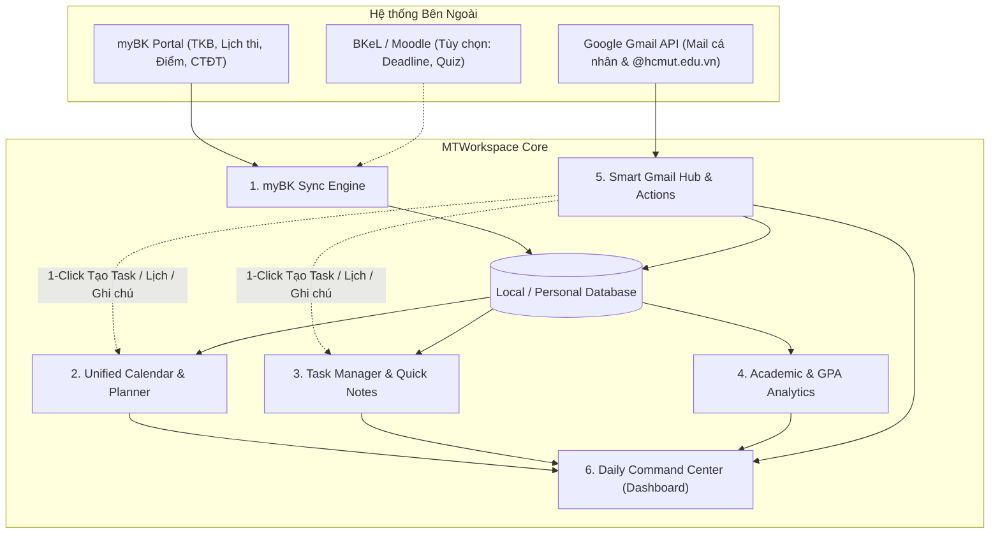

# Kế Hoạch Chi Tiết Hệ Thống Không Gian Làm Việc Cá Nhân (MTWorkspace)

> **Định hướng cốt lõi:** Xây dựng một nền tảng **All-in-One Personal Workspace** thiết kế riêng cho sinh viên Đại học Bách Khoa (HCMUT), kết hợp liền mạch giữa **dữ liệu học vụ thực tế từ myBK** với **quản lý công việc, lịch trình và kế hoạch cá nhân hằng ngày**.

---

## 1. Mục Tiêu & Giá Trị Cốt Lõi

1. **Tự động hóa thông tin học vụ:** Loại bỏ việc phải đăng nhập thủ công vào myBK nhiều lần để xem thời khóa biểu, phòng học, lịch thi hay kiểm tra điểm.
2. **Một nguồn lịch duy nhất (Single Source of Truth):** Hợp nhất lịch học trên trường, lịch thi, hạn nộp bài tập/đồ án với lịch làm việc và kế hoạch cá nhân trên cùng một giao diện.
3. **Liên kết ngữ cảnh Học tập – Công việc – Email:** Mọi công việc (Task), ghi chú (Note), email quan trọng (Gmail cá nhân & mail trường `@hcmut.edu.vn`), hay mục tiêu ôn tập đều được kết nối trực tiếp với lịch trình và từng môn học trong học kỳ.
4. **Riêng tư & An toàn dữ liệu:** Thông tin tài khoản SSO myBK, OAuth Token của Gmail và dữ liệu cá nhân được lưu trữ và mã hóa an toàn (Local-first hoặc Self-hosted).

---

## 2. Cấu Trúc Các Phân Hệ Chức Năng (Functional Modules)

---

### Phân hệ 1: Tích hợp & Đồng bộ Dữ liệu myBK (`myBK Sync Engine`)

Đóng vai trò là cầu nối lấy dữ liệu trực tiếp từ cổng ứng dụng sinh viên **`mybk.hcmut.edu.vn/app`** thông qua cơ chế xác thực `sso.hcmut.edu.vn` (CAS).

#### 1.1. Quản lý phiên đăng nhập & Đồng bộ
- **Đăng nhập SSO an toàn:** Hỗ trợ đăng nhập qua tài khoản Bách Khoa (lưu thông tin đăng nhập mã hóa cục bộ hoặc sử dụng Session/Cookie).
- **Cơ chế đồng bộ linh hoạt:**
  - *Đồng bộ thủ công (1-click Sync):* Nút "Làm mới dữ liệu từ myBK" ngay trên thanh công cụ.
  - *Đồng bộ định kỳ (Background Sync):* Tự động kiểm tra cập nhật mỗi ngày (đặc biệt hữu ích trong đợt công bố lịch thi hoặc nhập điểm).
  - *Chế độ Offline-first:* Luôn lưu bản sao dữ liệu trong Database cục bộ để truy cập tức thì ngay cả khi myBK bảo trì hoặc nghẽn mạng.

#### 1.2. Dữ liệu trích xuất từ myBK
| Nhóm dữ liệu | Chi tiết thông tin lấy về | Ứng dụng trong Workspace |
| :--- | :--- | :--- |
| **Thời khóa biểu (TKB)** | Mã môn, tên môn, nhóm-tổ, số tín chỉ, giảng viên, thứ, tiết học (quy đổi ra khung giờ thực tế), phòng học (`H1`, `H2`, `H6`, `B1`,...), cơ sở (CS1 Lý Thường Kiệt / CS2 Dĩ An), danh sách tuần học thực tế. | Tự động dựng lịch học chính xác theo từng tuần học Bách Khoa (vốn hay có tuần nghỉ hoặc học cách tuần). |
| **Lịch thi** | Kỳ thi (Giữa kỳ / Cuối kỳ), mã môn, ngày thi, giờ thi, thời lượng, phòng thi, cơ sở, mã số/ghế ngồi. | Tự động ghim vào Lịch, tạo bộ đếm ngược (Countdown) và gợi ý tạo chuỗi Task ôn thi trước 7–14 ngày. |
| **Điểm số** | Điểm thành phần (BT, TN, BTL, GK, CK), điểm tổng kết từng môn theo học kỳ, trạng thái đạt/chưa đạt. | Cảnh báo khi có môn vừa cập nhật điểm mới trên myBK; phục vụ tính toán GPA/CPA. |
| **Tiến độ học tập & CTĐT** | Tổng số tín chỉ tích lũy, tín chỉ bắt buộc / tự chọn theo khung Chương trình đào tạo, điều kiện ngoại ngữ / GDQP / GDTC. | Hiển thị thanh tiến độ hoàn thành khóa học (%) và gợi ý các môn cần đăng ký ở học kỳ tiếp theo. |
| **Mở rộng (Phase sau)** | Lịch sử học phí/công nợ, điểm rèn luyện, ngày công tác xã hội, và đồng bộ hạn nộp bài (Assignment/Quiz) từ **BKeL (LMS)**. | Tự động biến hạn nộp bài BKeL thành Task trong danh sách việc cần làm. |

---

### Phân hệ 2: Quản lý Thời gian & Lịch Hợp Nhất (`Unified Calendar & Planner`)

Giải quyết bài toán đặc thù của sinh viên Bách Khoa: **Tuần học của trường không trùng với tuần thông thường** và lịch học thay đổi theo từng tuần đăng ký.

- **Hiển thị Tuần học Bách Khoa (BK Academic Week):** Hiển thị song song ngày dương lịch và số thứ tự Tuần học theo chuẩn Đào tạo Bách Khoa (VD: *Tuần 12 - HK251*).
- **Chế độ xem đa dạng:** Ngày (Time-blocking theo giờ), Tuần, Tháng, và Agenda (Danh sách sự kiện sắp tới).
- **Phân lớp màu sắc (Calendar Layers):**
  - 🟦 **Lịch học myBK** (Tự động đồng bộ, gắn nhãn Cơ sở 1 / Cơ sở 2 và mã phòng).
  - 🟥 **Lịch thi myBK** (Ưu tiên cao nhất, nổi bật trên lịch).
  - 🟩 **Lịch làm việc / Cá nhân** (Họp nhóm, làm thêm, sự kiện cá nhân).
  - 🟨 **Time-block cho Task** (Kéo thả một công việc từ danh sách Task vào khung giờ trống trên lịch để lên kế hoạch làm việc trong ngày).
- **Ghi chú nhanh trên từng Môn học (Course Quick Memo):** Khi bấm vào bất kỳ ca học nào trên TKB, hiển thị một khung ghi chú nhỏ đính kèm của môn đó (dùng để lưu nhanh thông tin quan trọng như: *Email/SĐT giảng viên, link nhóm Zalo/Drive, tỉ lệ điểm hoặc dặn dò quan trọng của môn*).
- **Phát hiện xung đột thông minh:** Cảnh báo ngay khi bạn tạo sự kiện cá nhân bị trùng giờ học/giờ thi, hoặc khi hai sự kiện ở 2 cơ sở khác nhau (CS1 và CS2) quá sát giờ nhau không kịp di chuyển.

---

### Phân hệ 3: Quản lý Công việc, Kế hoạch & Ghi chú Nhanh (`Task Manager & Quick Notes`)

Thiết kế gọn nhẹ để quản lý song song **Việc học trên trường**, **Công việc / Dự án** và **Ghi chú quan trọng**.

- **Phân loại Không gian (Contexts / Tags):**
  - 🎓 **Học tập (Academic):** Các môn học trong học kỳ hiện tại được tự động tạo thành Tag từ dữ liệu TKB myBK (VD: `[CO2003] Cấu trúc dữ liệu & Giải thuật`).
  - 💼 **Công việc (Work / Side Projects):** Quản lý dự án cá nhân, thực tập, freelance.
  - 🌱 **Cá nhân (Personal Life):** Việc thường ngày, sức khỏe, thói quen.
- **Thuộc tính Task đầy đủ:**
  - Tiêu đề, mô tả chi tiết (hỗ trợ Markdown & Checklist con / Sub-tasks).
  - Hạn chót (Deadline), Ngày thực hiện (Scheduled Date).
  - Độ ưu tiên (P1 - Khẩn cấp/Quan trọng đến P4).
  - Trạng thái: `Backlog` → `To Do` → `In Progress` → `Review` → `Done`.
  - Hỗ trợ **Task lặp lại (Recurring Tasks)** (VD: "Chuẩn bị bài thí nghiệm mỗi tối Thứ 4", "Review kế hoạch tuần mỗi Chủ Nhật").
- **Ghi chú nhanh & Ghim thông tin (`Quick Notes / Pinned Memos`):**
  - Tích hợp sẵn khu vực **Quick Notes (Scratchpad)** để ghi nhanh thông tin quan trọng của môn học (quy định nộp BTL, link tài liệu, dặn dò của thầy cô) hoặc ghi chú công việc hằng ngày.
  - Có thể gắn Tag môn học/dự án cho ghi chú, ghim (`Pin`) các ghi chú quan trọng lên đầu, hoặc chuyển 1 dòng ghi chú thành Task chỉ với 1 cú nhấp chuột.
- **Chế độ hiển thị linh hoạt:**
  - **Today / Upcoming View:** Tập trung vào những việc cần giải quyết hôm nay và 7 ngày tới.
  - **Kanban Board:** Kéo thả trực quan theo trạng thái hoặc lọc theo từng môn học/dự án.
  - **Eisenhower Matrix:** Ma trận 4 góc phần tư (Quan trọng vs Khẩn cấp) để quyết định việc cần ưu tiên.

---

### Phân hệ 4: Phân tích Học tập & Mô phỏng GPA (`Academic Progress & GPA Simulator`)

Biến dữ liệu điểm và chương trình đào tạo từ myBK thành công cụ hoạch định chiến lược học tập.

- **Biểu đồ GPA & CPA qua các học kỳ:** Trực quan hóa xu hướng điểm trung bình học kỳ và điểm tích lũy theo thang 10 và thang 4.
- **Theo dõi Tiến độ Tốt nghiệp (Degree Audit):**
  - Thống kê trực quan: `Số tín chỉ đã tích lũy / Tổng tín chỉ yêu cầu`.
  - Phân tách theo khối kiến thức: Đại cương, Cơ sở ngành, Chuyên ngành, Tự chọn tự do, Thực tập & Đồ án/Luận văn.
- **Công cụ Dự báo & Đặt mục tiêu điểm ("What-if GPA Calculator"):**
  - Nhập trọng số điểm thành phần của các môn đang học trong kỳ (VD: BT 10%, TN 15%, BTL 25%, GK 20%, CK 30%).
  - Nhập các cột điểm đã biết (VD: đã có điểm GK và BT) → Hệ thống **tự động tính số điểm Cuối kỳ tối thiểu cần đạt** để đạt điểm chữ mục tiêu (`A+`, `A`, `B+`, `B`...) hoặc để kéo CPA lên mức mong muốn.

---

### Phân hệ 5: Theo dõi & Tác vụ Gmail Thông minh (`Smart Gmail Hub & Workflow Actions`)

Tích hợp trực tiếp tài khoản Gmail vào Workspace để bạn không bị bỏ lỡ thông báo quan trọng và có thể chuyển hóa ngay thông tin từ email thành hành động (Task/Lịch/Ghi chú).

#### 5.1. Kết nối Đa tài khoản (Multi-Account Sync)
- Hỗ trợ kết nối đồng thời **Gmail cá nhân (`@gmail.com`)** và **Email sinh viên Bách Khoa (`@hcmut.edu.vn` - nền tảng Google Workspace)** thông qua chuẩn bảo mật Google OAuth 2.0 (Gmail API).
- Đồng bộ theo thời gian thực (Push Notification / Polling định kỳ) các thư mới trong Hộp thư đến (Inbox).

#### 5.2. Phân luồng & Lọc Email Thông minh theo Ngữ cảnh
Thay vì hiển thị toàn bộ hộp thư hỗn độn như Gmail gốc, hệ thống tự động phân nhóm ưu tiên:
- 🎓 **Học vụ & Bách Khoa (Academic / HCMUT):** Tự động nhận diện và làm nổi bật email từ Phòng Đào tạo (AAO), Công tác sinh viên, thông báo từ hệ thống BKeL (Forum, hạn nộp Assignment/Quiz), hoặc email từ giảng viên có chứa **Mã môn học** bạn đang học trong kỳ (đối chiếu tự động với dữ liệu TKB từ myBK).
- 💼 **Công việc & Dự án (Work & Important):** Lọc theo danh sách người gửi quan trọng (VIP Senders), khách hàng, công ty, thông báo dự án (GitHub, Jira, lịch họp Google Meet).
- ⚡ **Cần xử lý (Needs Action / Follow-up):** Danh sách các email bạn đã đánh dấu "Cần làm", gắn sao (Starred), hoặc email có chứa từ khóa về thời hạn/lịch hẹn nhưng chưa phản hồi.

#### 5.3. Các Thao tác Hỗ trợ Trực tiếp (Quick Actions & Integrations)
- **Thao tác quản lý hộp thư nhanh (Inbox Zero Actions):**
  - Xem nhanh nội dung email & tệp đính kèm ngay trong cửa sổ trượt (Slide-over Panel) mà không cần rời khỏi Workspace.
  - Đánh dấu Đã đọc / Chưa đọc (`Mark Read/Unread`), Lưu trữ (`Archive`), Gắn sao (`Star`), Xóa (`Trash`), hoặc Tạm ẩn nhắc lại sau (`Snooze`).
  - **Phản hồi nhanh (`Quick Reply` & Templates):** Trả lời nhanh email ngay trong ứng dụng kèm các mẫu câu soạn sẵn (VD: mẫu email xin phép giảng viên, nộp bài, xác nhận lịch họp).
- **Chuyển hóa Email thành Công việc hoặc Ghi chú (`1-Click Email-to-Task / Note`):**
  - Nút **"Tạo Task / Lưu Ghi chú từ Email"**: Tự động lấy tiêu đề email làm tên Task hoặc lưu vào Ghi chú nhanh của môn học, kèm **đường dẫn (Deep-link) mở lại đúng email gốc**, tự động gắn Tag môn học nếu phát hiện mã môn, và gợi ý Deadline nếu trong email có nhắc đến ngày giờ.
- **Trích xuất Sự kiện vào Lịch (`1-Click Email-to-Calendar`):**
  - Khi nhận được email báo **lịch học bù, đổi phòng học, lịch họp nhóm hay lịch phỏng vấn**, chỉ cần 1 cú nhấp để thêm trực tiếp vào **Unified Calendar** (tự động kiểm tra xem có trùng với TKB myBK hay không).

---

### Phân hệ 6: Bảng Điều Khiển Trung Tâm (`Daily Command Center`)

Màn hình trang chủ mỗi khi bạn mở hệ thống vào buổi sáng:

1. **Briefing Hôm nay ("Today at a Glance"):**
   - Hôm nay là Thứ mấy, Ngày nào, **Tuần học thứ bao nhiêu của Bách Khoa**.
   - Các ca học trong ngày (Môn gì, mấy giờ, phòng nào, cơ sở nào, ca tiếp theo còn bao lâu nữa bắt đầu, kèm ghi chú ghim của môn đó nếu có).
2. **Tiêu điểm Công việc & Ghi chú ghim (Top Priorities & Pinned Notes):**
   - 3–5 Task quan trọng nhất cần hoàn thành trong ngày + các Task sắp quá hạn + khung Scratchpad ghi chú nhanh.
3. **Điểm tin Gmail quan trọng (Gmail Priority Widget):**
   - Hiển thị nhanh số lượng email chưa đọc quan trọng (ưu tiên email từ trường/giảng viên và công việc) kèm nút thao tác nhanh (`Đánh dấu đã đọc`, `Chuyển thành Task`, `Trả lời nhanh`) ngay trên Dashboard.
4. **Đếm ngược sự kiện quan trọng (Exam & Milestone Countdown):**
   - Hiển thị các kỳ thi giữa kỳ/cuối kỳ hoặc deadline đồ án lớn sắp diễn ra trong 14–30 ngày tới.
5. **Hệ thống Nhắc nhở (Notifications):**
   - Thông báo trên máy tính (hoặc tích hợp Bot Telegram cá nhân): Nhắc lịch học trước 30 phút (kèm số phòng), nhắc hạn nộp task buổi sáng, báo khi có email quan trọng từ giảng viên/trường, và báo ngay khi myBK có điểm mới.

---

## 3. Kiến Trúc Kỹ Thuật & Công Nghệ Đã Chốt (Confirmed Tech Stack)

Hệ thống được thiết kế theo mô hình **Web App chạy Local-first**, sẵn sàng mở rộng tích hợp đa dịch vụ (myBK, Gmail, Telegram):

| Thành phần | Công nghệ sử dụng (Đã chốt) | Vai trò & Chi tiết triển khai |
| :--- | :--- | :--- |
| **Giao diện (Frontend)** | **Next.js (React) + TypeScript + Tailwind CSS + shadcn/ui** | Giao diện hiện đại (phong cách Notion/Linear), phản hồi tức thì, sử dụng hệ thống component chuẩn của `shadcn/ui` cho Lịch, Bảng Kanban, Slide-over Email, Biểu đồ. |
| **Backend & API** | **Node.js (Next.js API Routes / NestJS)** | Xử lý trung tâm cho các luồng đồng bộ `myBK`, tích hợp `Gmail API`, quản lý tác vụ ngầm (Background Cronjobs) và kết nối `Telegram Bot` ở các giai đoạn mở rộng. |
| **Module kết nối myBK** | **Playwright / Puppeteer** + **HTTP Client (Axios)** | Đăng nhập qua `sso.hcmut.edu.vn` (CAS) và trích xuất dữ liệu trực tiếp từ cổng **`mybk.hcmut.edu.vn/app`** (Thời khóa biểu, Lịch thi, Điểm số, Tiến độ học tập). |
| **Module kết nối Gmail** | **Google OAuth 2.0 + Official Gmail REST API (`googleapis`)** | Hỗ trợ kết nối đồng thời **2 tài khoản**: Gmail cá nhân (`@gmail.com`) và Email sinh viên Bách Khoa (`@hcmut.edu.vn`) để theo dõi và thao tác trực tiếp. |
| **Cơ sở dữ liệu** | **PostgreSQL** (kết hợp **Prisma ORM** hoặc **Drizzle ORM**) | Lưu trữ toàn bộ dữ liệu học vụ từ myBK, cấu hình tài khoản, Task, Lịch cá nhân, Ghi chú và Metadata Email với hiệu năng truy vấn và tính toàn vẹn dữ liệu cao. |
| **Môi trường vận hành** | **Web App chạy Local (`localhost`)** | Chạy trực tiếp trên máy cá nhân (kết nối PostgreSQL local / Docker), đảm bảo tốc độ nhanh và an toàn dữ liệu tuyệt đối. |

---

## 4. Lộ Trình Xây Dựng (Implementation Roadmap)

Để nhanh chóng có sản phẩm dùng được ngay và nâng cấp dần, dự án được chia làm **4 Giai đoạn (Phases)**:

### 🚀 Phase 1: Nền tảng PostgreSQL & Kết nối `mybk.hcmut.edu.vn/app` (MVP - Core Academic Sync)
- [ ] Khởi tạo dự án **Next.js + TypeScript + Tailwind CSS + shadcn/ui** và cấu hình **PostgreSQL** (Database Schema cho Môn học + Ghi chú môn học, Lịch học, Lịch thi, Điểm, Task, Sự kiện, Email Metadata).
- [ ] Xây dựng `myBK Connector`: Xác thực SSO Bách Khoa và đồng bộ dữ liệu Thời khóa biểu, Lịch thi, Bảng điểm trực tiếp từ **`mybk.hcmut.edu.vn/app`** về PostgreSQL.
- [ ] Xây dựng giao diện **Dashboard cơ bản**: Hiển thị lịch học trong ngày/tuần (kèm số tuần Bách Khoa) và danh sách lịch thi sắp tới.

### 📅 Phase 2: Quản lý Công việc, Ghi chú nhanh, Lịch Hợp Nhất & Đa tài khoản Gmail (Productivity & Communication Core)
- [ ] Xây dựng phân hệ **Task Management & Quick Notes** (Tạo, sửa, xóa task, ghi chú nhanh/ghim thông tin quan trọng theo tag môn học từ myBK, chế độ xem Today & Kanban).
- [ ] Xây dựng **Unified Calendar**: Hiển thị chung TKB myBK (bấm vào môn học xem/sửa ngay ghi chú ghim của môn đó), Lịch thi và Sự kiện/Task cá nhân trên cùng một lịch tuần/tháng; hỗ trợ kéo thả Time-blocking.
- [ ] Xây dựng **Smart Gmail Hub**: Kết nối Google OAuth 2.0 cho cả **Gmail cá nhân (`@gmail.com`)** và **Mail sinh viên (`@hcmut.edu.vn`)**, phân loại email thông minh, thao tác nhanh (Đọc, Archive, Star, Quick Reply) và tính năng **1-Click chuyển Email thành Task / Ghi chú / Lịch**.

### 📊 Phase 3: Phân tích Điểm số & Tiến độ Học tập (Academic Intelligence)
- [ ] Xây dựng trang **Bảng điểm & Tiến độ CTĐT**: Biểu đồ GPA/CPA qua các kỳ, thống kê tín chỉ tích lũy.
- [ ] Xây dựng công cụ **What-if GPA Simulator** (Tính điểm thành phần & điểm thi cuối kỳ cần đạt).

### ⚡ Phase 4: Tự động hóa & Kết nối Telegram (Polish & Automation)
- [ ] Tự động đồng bộ ngầm (Background Sync) & phát hiện thay đổi (thông báo khi có điểm mới, đổi phòng học/lịch thi, hoặc có email khẩn từ giảng viên).
- [ ] Tích hợp **Telegram Bot** cá nhân để nhận thông báo nhắc lịch học, deadline, điểm mới và email quan trọng ngay trên điện thoại.

---

## 5. Tổng Hợp Các Quyết Định Đã Chốt (Confirmed Decisions)

- ✅ **Hình thức triển khai:** Web App chạy Local (`localhost`) trước tiên.
- ✅ **Frontend Stack:** Next.js (React) + TypeScript + Tailwind CSS + `shadcn/ui`.
- ✅ **Backend Stack:** Node.js (Next.js API / NestJS) xử lý kết nối myBK, Gmail API và mở rộng Telegram Bot về sau.
- ✅ **Cơ sở dữ liệu:** PostgreSQL.
- ✅ **Nguồn dữ liệu myBK:** Đồng bộ trực tiếp từ cổng ứng dụng sinh viên **`mybk.hcmut.edu.vn/app`** (qua SSO Bách Khoa).
- ✅ **Phạm vi tích hợp Gmail:** Hỗ trợ kết nối đồng thời cả **Gmail cá nhân (`@gmail.com`)** và **Email sinh viên (`@hcmut.edu.vn`)**.
- ✅ **Quản lý thông tin môn học:** Tinh gọn — bỏ trang Không gian môn học riêng lẻ, tích hợp ghi chú quan trọng của môn học trực tiếp vào thẻ môn học trên Lịch/TKB và phân hệ Quick Notes/Task.
